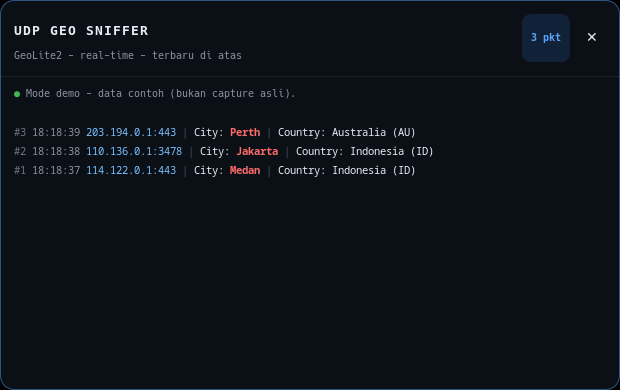

# UDP Geo Sniffer

Overlay kecil di pojok kanan atas layar (Linux/GNOME) yang menampilkan paket
UDP beserta **kota** dan **negara** source IP, plus ekstensi Wireshark untuk
melihat dan memfilter City/Country langsung dari capture.



Output contoh:

```
#1 [UDP] 114.122.0.1:443 | City: Medan | Country: Indonesia (ID)
#2 [UDP] 110.136.0.1:3478 | City: Jakarta | Country: Indonesia (ID)
```

> **Penting — database GeoIP wajib ada.** File `GeoLite2-City.mmdb` **tidak
> disertakan** di repo ini karena lisensi MaxMind. Tanpa file tersebut,
> city/country tidak akan tampil. Unduh gratis di
> **<https://www.maxmind.com/en/geolite2/signup>** (perlu akun MaxMind),
> atau biarkan Wireshark mengunduhnya otomatis saat pertama kali dipakai.

## Fitur

- Overlay GTK3 selalu di atas, diposisikan di kanan atas layar.
- Kota ditampilkan merah, negara beserta kode ISO.
- Dua versi capture:
  - **tshark/dumpcap** — tanpa root, memakai database GeoIP milik Wireshark.
  - **standalone** — tanpa tshark/Wireshark sama sekali, memakai raw socket
    Linux (`AF_PACKET`) dan `libmaxminddb` lewat `ctypes`.
- Mode `--console`, `--demo`, dan `--unique`.
- Ekstensi Lua Wireshark: field `udpgeo.*` siap dipakai sebagai kolom/filter.
- Profil Wireshark **UDP-Geo** dengan kolom City/Country.

## Perbandingan versi

| | `geo_udp_sniffer.py` | `geo_udp_sniffer_standalone.py` |
|---|---|---|
| Butuh tshark/Wireshark | Ya | **Tidak** |
| Butuh root/CAP_NET_RAW | Tidak | **Ya** |
| Database GeoIP | GeoLite2 milik Wireshark | `GeoLite2-City.mmdb` via libmaxminddb |
| Parsing paket | tshark | Ethernet, VLAN, IPv4, IPv6, UDP |
| Overlay GTK3 | Ya | Ya |

## Kebutuhan

Arch/CachyOS:

```bash
# versi tshark + ekstensi Wireshark
sudo pacman -S --needed wireshark-cli python-gobject gtk3

# versi standalone (Wireshark tidak perlu)
sudo pacman -S --needed python-gobject gtk3 libmaxminddb
```

Debian/Ubuntu:

```bash
# versi tshark
sudo apt install tshark python3-gi gir1.2-gtk-3.0

# versi standalone
sudo apt install python3-gi gir1.2-gtk-3.0 libmaxminddb0
```

Pastikan user ada di grup `wireshark` agar `dumpcap` bisa capture tanpa root:

```bash
sudo usermod -aG wireshark "$USER"
```

Logout/login (atau reboot) setelah menambahkan grup.

## Cara pakai

### 1. Versi tshark (tanpa root)

```bash
./geo_udp_sniffer.py                 # overlay kanan atas
./geo_udp_sniffer.py --console       # tampil di terminal
./geo_udp_sniffer.py --demo          # data contoh
./geo_udp_sniffer.py --unique        # tiap source IP sekali
./geo_udp_sniffer.py -i enp7s0       # pilih interface
./geo_udp_sniffer.py --filter "udp"  # BPF filter
```

Opsi tampilan: `--monitor N`, `--margin N`, `--width N`, `--height N`,
`--rows N`.

### 2. Versi standalone (butuh root)

```bash
sudo -E ./geo_udp_sniffer_standalone.py            # overlay + capture
sudo -E ./geo_udp_sniffer_standalone.py --console  # tampil di terminal
./geo_udp_sniffer_standalone.py --demo             # tes overlay tanpa root
sudo -E ./geo_udp_sniffer_standalone.py --unique   # tiap IP sekali
sudo -E ./geo_udp_sniffer_standalone.py -i enp7s0
sudo -E ./geo_udp_sniffer_standalone.py --db /path/GeoLite2-City.mmdb
```

`-E` pada `sudo` penting agar `DISPLAY` dan `XAUTHORITY` ikut terbawa ke
proses root.

Alternatif tanpa menjalankan seluruh shell sebagai root: beri capability
pada binary Python.

```bash
sudo setcap cap_net_raw+ep "$(readlink -f "$(command -v python3)")"
```

Hentikan dengan tombol **x** di overlay atau `Ctrl+C` di terminal.

## Ekstensi Wireshark

Salin plugin dan profil:

```bash
./install.sh
```

Atau manual:

```bash
mkdir -p ~/.local/lib/wireshark/plugins
cp wireshark/geo_udp.lua ~/.local/lib/wireshark/plugins/

mkdir -p ~/.config/wireshark/profiles/UDP-Geo
cp wireshark/UDP-Geo/preferences ~/.config/wireshark/profiles/UDP-Geo/
```

Lalu di Wireshark:

1. **Analyze → Reload Lua Plugins** (atau restart Wireshark).
2. Pilih profil **UDP-Geo** di menu profil kanan bawah.

Field yang tersedia:

- `udpgeo.src_city`, `udpgeo.src_country`, `udpgeo.src_country_iso`
- `udpgeo.dst_city`, `udpgeo.dst_country`, `udpgeo.dst_country_iso`
- `udpgeo.src_location`, `udpgeo.dst_location`

Contoh display filter:

```
udpgeo.src_city == "Jakarta"
udpgeo.src_country == "Indonesia"
udpgeo.src_location contains "Medan"
udpgeo.src_country_iso == "ID"
```

## Database GeoLite2 (wajib)

Repo ini **tidak menyertakan** `GeoLite2-City.mmdb` karena lisensinya milik
MaxMind dan tidak boleh didistribusikan ulang di repo publik. Database ini
**wajib** agar city/country bisa ditampilkan.

Link download resmi MaxMind:

- Daftar akun gratis: **<https://www.maxmind.com/en/geolite2/signup>**
- Halaman download (setelah login):
  **<https://www.maxmind.com/en/accounts/current/geoip/downloads>**
- Info lisensi & data GeoLite2:
  **<https://dev.maxmind.com/geoip/geolite2-free-geolocation-data>**

Pilih **GeoLite2 City → Download GZIP (.tar.gz)**, lalu ekstrak dan salin:

```bash
tar -xzf GeoLite2-City_*.tar.gz
mkdir -p ~/.local/share/wireshark/maxmind
cp GeoLite2-City_*/GeoLite2-City.mmdb ~/.local/share/wireshark/maxmind/
```

Alternatif tanpa akun MaxMind: buka Wireshark sekali dan aktifkan
**Edit → Preferences → Name Resolution → Enable MaxMind geolocation**.
Wireshark akan mengunduh database ke
`~/.local/share/wireshark/maxmind/`.

Lokasi file yang dicari aplikasi:

- `~/.local/share/wireshark/maxmind/GeoLite2-City.mmdb`
- `~/.local/share/GeoIP/GeoLite2-City.mmdb`
- `/usr/share/GeoIP/GeoLite2-City.mmdb`
- `/usr/share/wireshark/maxmind/GeoLite2-City.mmdb`

Atau tentukan langsung dengan `--db /path/GeoLite2-City.mmdb` pada versi
standalone.

## Catatan

- Window dipaksa lewat **XWayland** (`GDK_BACKEND=x11`) supaya bisa
  diposisikan di kanan atas dan selalu di atas. Di Wayland murni, compositor
  yang menentukan posisi window.
- Kota bisa tampil **Unknown City** untuk IP anycast seperti Google
  (`74.125.x.x`, `142.250.x.x`) atau Cloudflare. Negara tetap tampil.
- Tanpa root, versi standalone menampilkan pesan:
  `Butuh izin root/CAP_NET_RAW`.
- Jika GTK menolak terbuka saat dijalankan sebagai root, pakai versi tshark
  atau jalankan versi standalone dengan `--console`.

## Struktur repo

```
.
├── geo_udp_sniffer.py              # versi tshark/dumpcap
├── geo_udp_sniffer_standalone.py   # versi raw socket + libmaxminddb
├── install.sh                      # pasang plugin + profil + launcher
├── wireshark/
│   ├── geo_udp.lua
│   └── UDP-Geo/preferences
├── desktop/                        # launcher GNOME
├── docs/screenshot.png
└── legacy/                         # versi Windows lama
```

## Lisensi

Belum ditentukan. Tambahkan file `LICENSE` sebelum dipublikasikan bila perlu.
